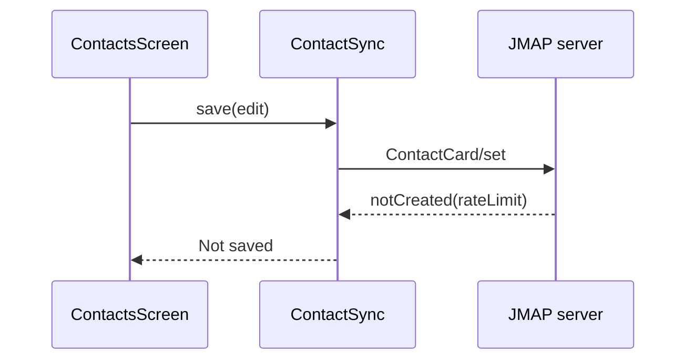

# Published review format

This file sets the layout of the review that [ready-for-review.md](ready-for-review.md) posts on
GitHub. The layout follows the CodeRabbit style: a summary review with collapsible sections, plus
one inline comment per finding. The evidence rules in [review-guide.md](review-guide.md) still
decide what counts as a finding; this file only decides how a finding looks on the PR.

Post everything as one GitHub review with `event: COMMENT`, `commit_id` set to the reviewed head,
the summary below as `body`, and the inline comments in `comments`. Never post a second summary
as an issue comment.

## Severity badges

Each finding carries a kind and a severity badge. The kind says what the reader must do; the badge
maps the guide's P0 to P3 levels.

| Kind | Use it for |
| --- | --- |
| `⚠️ Potential issue` | A confirmed defect: wrong behavior, data loss, a crash, a broken contract. |
| `🛠️ Refactor suggestion` | A concrete engineering-rule violation with a named maintenance cost. |
| `🧹 Nitpick` | A minor, actionable fix. Always P3, and always in the nitpick section, never inline. |

| Severity | Badge |
| --- | --- |
| P0 | `🔴 Critical` |
| P1 | `🟠 Major`, and the finding to fix before merge |
| P2 | `🟠 Major` when a user can hit it in a supported flow, otherwise `🟡 Minor` |
| P3 | `🔵 Trivial` |

The highest finding sets the merge risk: Critical for any P0, High for any P1, Medium for a Major
P2, Low for a Minor P2 or only P3s, and Minimal with no findings. Three or more Major P2s raise
Medium to High. A finding with medium confidence counts one step lower.

## Summary body

Write the sections in this order. Leave out a section that has nothing to say, except the review
info section.

````markdown
<!-- otus-opus-review:v1:<review-key-digest> -->
**Actionable comments posted: <n>**

<one or two sentences: the verdict, and the finding to fix first>

**Merge risk:** <badge> <Minimal | Low | Medium | High | Critical> · up to `<head sha7>`
<one sentence naming what drives the risk>

<details>
<summary><strong>Walkthrough</strong></summary>

<two to four sentences on what the PR does for the user, in the reviewer's own words>

**Changes**

| Layer / file(s) | Summary |
| :--- | :--- |
| **<layer>** <br> `path/A.kt`, `path/B.kt` | <what changed and why, one or two sentences> |

**Sequence diagram**



**Estimated review effort:** <1 to 5> (<Trivial | Simple | Moderate | Complex | Critical>) | ~<n> minutes
**Change type:** <bug fix | feature | refactor | docs | build>
**Partner PR:** <reazndev/otus-mail#123, or "none">
**Possibly related PRs:** <links with one line each, or leave out>

</details>

<details>
<summary><strong>Pre-merge checks: ✅ <n> · ❌ <n> · ❔ <n></strong></summary>

| Check | Status | Explanation |
| :--- | :---: | :--- |
| Title | ✅ | <follows `type(scope): short action`, reads as a changelog line, at most 72 characters> |
| Description | ❌ | <which template headings are missing or out of order> |
| Linked issue | ✅ | <issue link, and whether the PR does what it asks> |
| Out of scope | ✅ | <changes the title and description do not mention> |
| Changelog | ✅ | <Meta only: public API or behavior changes listed under "Unreleased"> |
| Meta partner | ❔ | <Mail only: the Meta branch it builds against has the API this PR uses, and merges first> |

</details>

<details>
<summary><strong>⚠️ Outside diff range comments (<n>)</strong></summary>

<findings whose location is not in the diff, each formatted like an inline comment with its
`path` and line range as a heading>

</details>

<details>
<summary><strong>🧹 Nitpick comments (<n>)</strong></summary>

<details>
<summary><code>path/File.kt</code> (<n>)</summary>

`L40-44`: <the nitpick, and the fix in one sentence>

</details>

</details>

<details>
<summary><strong>Review info</strong></summary>

**Model:** <actual model id>, <lenses run>
**Instructions:** reazndev/otus-meta@<instruction sha7>
**Commits:** `<base sha7>`...`<head sha7>`, <n> commits
**Files processed:** <n> of <n>; <skipped files and why>
**Checks:** <each command and its result, or why it could not run>
**CI at head:** <passed and failed jobs, and jobs still running>
**Coverage gaps:** <what was not read or not run>
**Checked, no finding:** <areas traced that turned up nothing>

</details>
````

Draw the sequence diagram only when the PR changes a flow that crosses three or more components,
such as UI, state, repository, and server. Name participants after the real classes. Show the
changed path, not the whole app.

Estimate review effort from the size and spread of the diff: 1 is a one-file fix a reader checks
in a few minutes, 5 is a cross-module change with new persisted state or protocol behavior.

## Inline comment

Post each confirmed finding that sits inside the diff as an inline comment on its smallest line
range. Use `line` and `side: RIGHT`, with `start_line` for a range. A finding whose lines are not
in the diff goes to the outside-diff section instead.

````markdown
_⚠️ Potential issue_ | _🟠 Major_ | _Confidence: high_

**<One sentence naming the failure.>**

<The trigger, the code path, and what the user sees. Cite other files as `path:line`. Say whether
a test reproduced it or a source trace proved it.>

<details>
<summary>🔧 Suggested fix</summary>

```suggestion
<replacement for exactly the commented lines>
```

</details>

<details>
<summary>🧪 Regression test</summary>

<the test that would have caught it, with the class and the assertion>

</details>

<details>
<summary>🤖 Prompt for AI agents</summary>

```text
In <path> around lines <start>-<end>, <what is wrong>. <What to change, naming the functions>.
Add <test> in <test file> that <assertion>. Verify with <gradle task>.
```

</details>
````

Use a `suggestion` block only when the replacement is complete, compiles in context, and covers
exactly the commented lines, so GitHub's "Commit suggestion" button produces working code. For a
change that spans other lines or files, use a `diff` block instead and say it is a sketch.

Write the AI-agent prompt so an agent with no access to this review can apply the fix. Name the
file, the lines, the change, and the check that proves it.

## Clean review

When no finding survives, post the summary with "No confirmed findings in the reviewed scope."
in place of the verdict line, and keep the walkthrough, the pre-merge checks, and the review
info. A clean review does not approve the PR.
